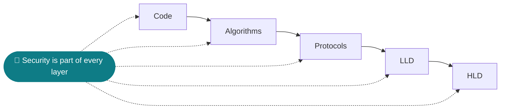
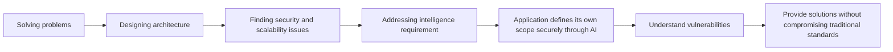
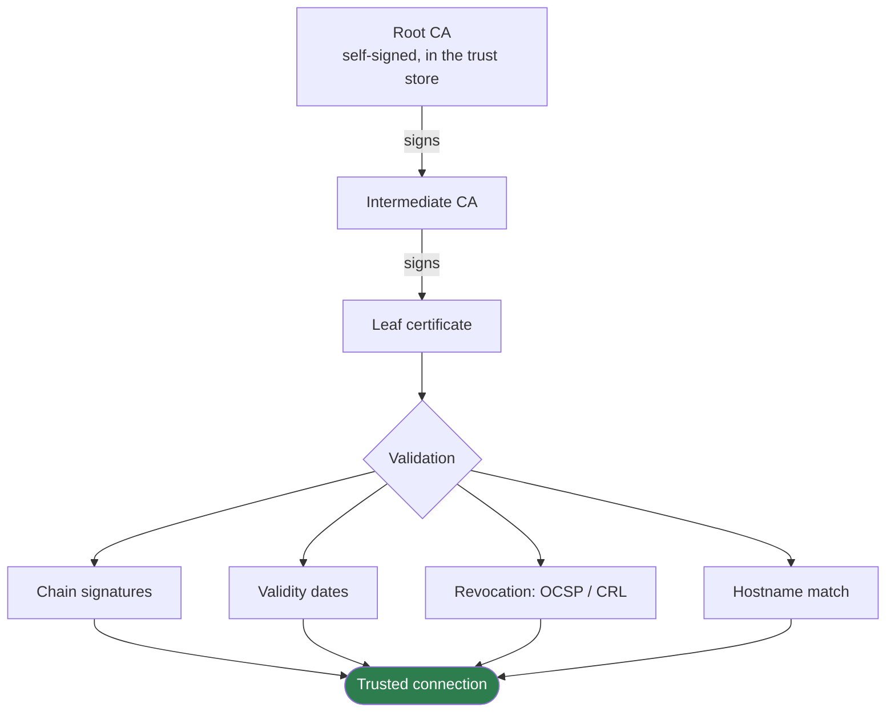
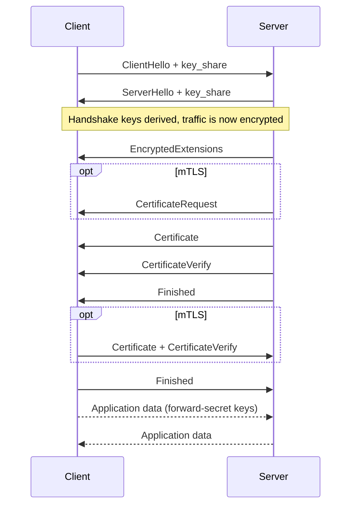
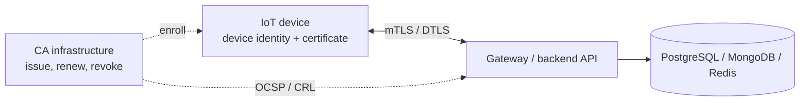
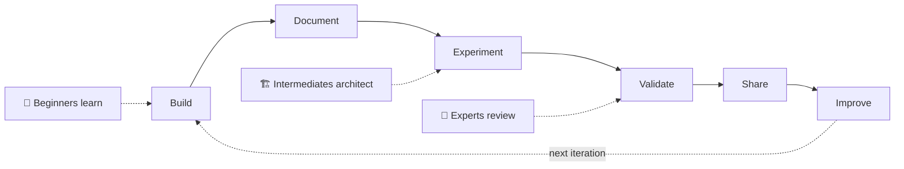

## Hi I am Siva Guru, 
## can verify me @76e2d5c4bcc52001085c7b25251ed620b01677455b5e45441776f0fa4aa9a7b6 👋

<!--
**Siva27Guru/Siva27Guru** is a ✨ _special_ ✨ repository because its `README.md` (this file) appears on your GitHub profile.

Here are some ideas to get you started:

- 🔭 I’m currently working on ...
- 🌱 I’m currently learning ...
- 👯 I’m looking to collaborate on ...
- 🤔 I’m looking for help with ...
- 💬 Ask me about ...
- 📫 How to reach me: ...
- 😄 Pronouns: ...
- ⚡ Fun fact: ...
-->
# 🧭 My Engineering Philosophy

I approach engineering from the security perspective:

**Code → Algorithms → Protocols → LLD → HLD**

I believe secure systems are not created by adding security at the end. They are designed with security as a fundamental part of the architecture.

---

# 🔬 Current Technical Focus

Started with Solving Problems Designing architecture Finding Security and Scalability issues Addressing Intelligence requirement for better solution expanding to recieve help for an application to define its own scope in secure way thru AI In Security Engineer & Researching Journey to understand figureout Vulnerabilities to Providing Solutions without compromising traditional standards to suit modern update

Now Focusing on Public Key Infrastructure (PKI), digital certificates, cryptographic systems, and secure communication protocols. My work combines product development and R&D, exploring practical applications of security technologies across modern authentication and communication systems.

### Current work areas

- **PKI & Certificate Management** — X.509, certificate lifecycle, CA infrastructure, OCSP, CRL
- **Cryptography** — RSA, ECC, EdDSA, Post-Quantum Cryptography, and FHE
- **Secure Protocols** — TLS 1.3, mTLS, DTLS, and certificate-based authentication
- **Identity & Authentication** — WebAuthn, FIDO2, IAM, and passwordless authentication
- **IoT Security** — Device identity, trust establishment, and secure device communication
- **Backend Engineering** — Python (Django/Flask), Golang, REST APIs, PostgreSQL, MongoDB, Redis
- **System Design** — LLD, HLD, distributed systems, security architecture, and scalable backend design

mindmap
  root((Security Engineering))
    PKI and Certificates
      PKI Architecture
      Root CA and Sub CA
      X.509 and C.509
      ASN.1 DER PEM
      CSR Processing
      Certificate Lifecycle
      Certificate Issuance
      Certificate Renewal
      Certificate Revocation
      CRL
      OCSP
      Certificate Validation
      PKCS11
      HSM Integration
      Key Management
      PKI Automation

    Cryptography
      Symmetric Cryptography
        AES
        AES GCM
        ChaCha20
      Asymmetric Cryptography
        RSA
        ECC
        ECDSA
        EdDSA
        ECDH
      Hashing and Integrity
        SHA 256
        SHA 3
        HMAC
        HKDF
      Digital Signatures
      Key Exchange
      Random Number Generation
      Post Quantum Cryptography
        ML KEM
        ML DSA
        SLH DSA
        Hybrid Cryptography
      Fully Homomorphic Encryption
      Secure Multiparty Computation

    Secure Protocols
      TLS 1.2 and TLS 1.3
      Mutual TLS
      DTLS
      MQTT over TLS
      CoAP
      OSCORE
      Certificate Based Authentication
      OAuth 2.0
      OpenID Connect
      SAML
      RADIUS
      TCP IP
      UDP
      DNS
      Wireshark
      Packet Analysis

    Identity and Authentication
      WebAuthn
      FIDO2
      CTAP2
      Passkeys
      Platform Authenticators
      Roaming Authenticators
      Synced Passkeys
      Resident Credentials
      User Verification
      IAM
      RBAC
      ABAC
      Privileged Access Management
      JWT
      PKCE
      Session Management

    IoT and Embedded Security
      Device Identity
      Device Provisioning
      Device Certificate Enrollment
      Trust Establishment
      Secure Device Communication
      Secure Boot
      Measured Boot
      Firmware Signing
      Remote Attestation
      Embedded Linux
      Linux
      FreeRTOS
      QNX
      ARM Architecture
      TPM
      Secure Elements
      Crypto Accelerators
      Lightweight Cryptography
      CBOR
      C.509

    Backend Engineering
      Programming Languages
        Python
        JavaScript
        Golang
        C
      Frameworks
        Django
        Django REST Framework
        Flask
        FastAPI
        PyQt6
      API Engineering
        REST APIs
        Authentication
        Authorization
        Rate Limiting
      Databases
        PostgreSQL
        MongoDB
        Redis
      Application Security
        OWASP Top 10
        Input Validation
        Secure Sessions
        Secrets Management
      Testing
        Unit Testing
        Integration Testing
        API Testing
        Security Testing

    AI and Machine Learning
      Mathematics and Statistics
      Python for AI
      Machine Learning
        Supervised Learning
        Unsupervised Learning
        Reinforcement Learning
      Deep Learning
        Neural Networks
        CNN
        Transformers
      Natural Language Processing
      Generative AI
        LLMs
        Embeddings
        Prompt Engineering
        Fine Tuning
      RAG
      Vector Databases
      AI Agents
      Multi Agent Systems
      Model Context Protocol
      AI Model Evaluation
      AI Assisted Development

    AI for Cybersecurity
      AI Based Threat Detection
      PKI Anomaly Detection
      Certificate Risk Prediction
      Security Log Analysis
      Intelligent Certificate Monitoring
      Malware Detection
      Intrusion Detection
      Vulnerability Analysis
      AI Driven SOC
      Automated Security Testing
      Threat Intelligence
      LLM Security
      Prompt Injection
      RAG Security
      AI Model Security
      Adversarial Machine Learning

    Infrastructure and DevSecOps
      Linux Administration
      Ubuntu and Debian
      Networking
      Git and GitHub
      GitLab
      Docker
      Proxmox
      Nginx
      Gunicorn
      CI CD Pipelines
      Terraform
      OpenTofu
      Ansible
      Cloud Infrastructure
      HPC
      Secrets Management
      Monitoring
      Logging
      Deployment Automation

    System Design
      Problem Solving
      Data Structures and Algorithms
      Time and Space Complexity
      OOP
      SOLID Principles
      Design Patterns
      LLD
      HLD
      Distributed Systems
      Microservices
      Scalability
      Load Balancing
      Fault Tolerance
      Caching
      Concurrency
      Asynchronous Processing
      Security Architecture
      Zero Trust Architecture
      Defense in Depth
      Threat Modeling
      Performance Engineering

**Expanding Technical Focus:** IoT and Embedded Systems Security for Lightweight Systems; AI/ML for Innovative Systems; Backend Architecture; Cloud Technologies and MCP-based Infrastructure Automation.

I believe secure systems are not created by adding security at the end—they are designed with security as a fundamental part of the architecture.

Exploring how cryptography, PKI, authentication, protocols, and architecture can come together to build secure, scalable, and reliable technology solutions.

### 🧩 How the pieces fit together (click to expand)

<b>PKI: how a certificate earns trust</b>

<b>TLS 1.3 handshake (with optional mTLS)</b>

<b>Where the layers meet in an IoT deployment</b>

---

# 🌍 My Open-Source Journey

My intention is to:

- Document what I learn consistently.
- Convert theoretical knowledge into practical experiments.
- Implement real-world use cases.
- Improve my problem-solving and architectural thinking.
- Maintain reusable technical references.
- Gradually develop complete, well-documented projects.

Contribute practical implementations and project code to the open-source community in the coming months. My vision is to create open-source repositories that empower everyone to learn, experiment, architect, implement, and validating ideas through practical implementation — ultimately extending their capabilities from the physical world into a secure digital space.

I want every project in my repositories to create a meaningful learning and collaboration environment for developers at different stages of their engineering journey.

| Level | Focus | What it means |
|---|---|---|
| 🌱 **Beginners** | Learn by Building | Understand programming fundamentals, explore real-world use cases, and discover the practical value of technology through hands-on implementation. |
| 🏗️ **Intermediate Developers** | Think and Architect | Develop decision-making capabilities by evaluating design choices, comparing approaches, understanding trade-offs, and improving architectural efficiency, scalability, and security. |
| 🚀 **Experts** | Review, Challenge and Innovate | Share technical expertise, challenge existing implementations, identify improvement opportunities, and contribute suggestions that make projects more efficient, secure, scalable, and reliable. |

My intention is to make every repository a shared engineering space where beginners learn, intermediates develop architectural thinking, and experts help drive continuous improvement.

Because meaningful open-source development happens when knowledge flows in every direction.

**Build → Document → Experiment → Validate → Share → Improve.**

---

# 💬 Let's Connect

If you are interested in cryptography, PKI, cybersecurity, security research, architecture, or open-source engineering, let's exchange ideas and build something meaningful.

💻 GitHub: [@Siva27Guru](https://github.com/Siva27Guru)

💼 LinkedIn: Connect with me

---

# ⚡ A Continuous Engineering Journey

**Consistent Learning. Reliable Building. Practical Research. Open-Source Contribution.**

Understanding problems deeply, designing securely, and continuously seeking better ways to solve complex engineering challenges.

💼 LinkedIn: Connect with me

⚡ A Continuous Engineering Journey

Consistent Learning. Reliable Building. Practical Research. Open-Source Contribution.

Understanding problems deeply, designing securely, and continuously seeking better ways to solve complex engineering challenges.
